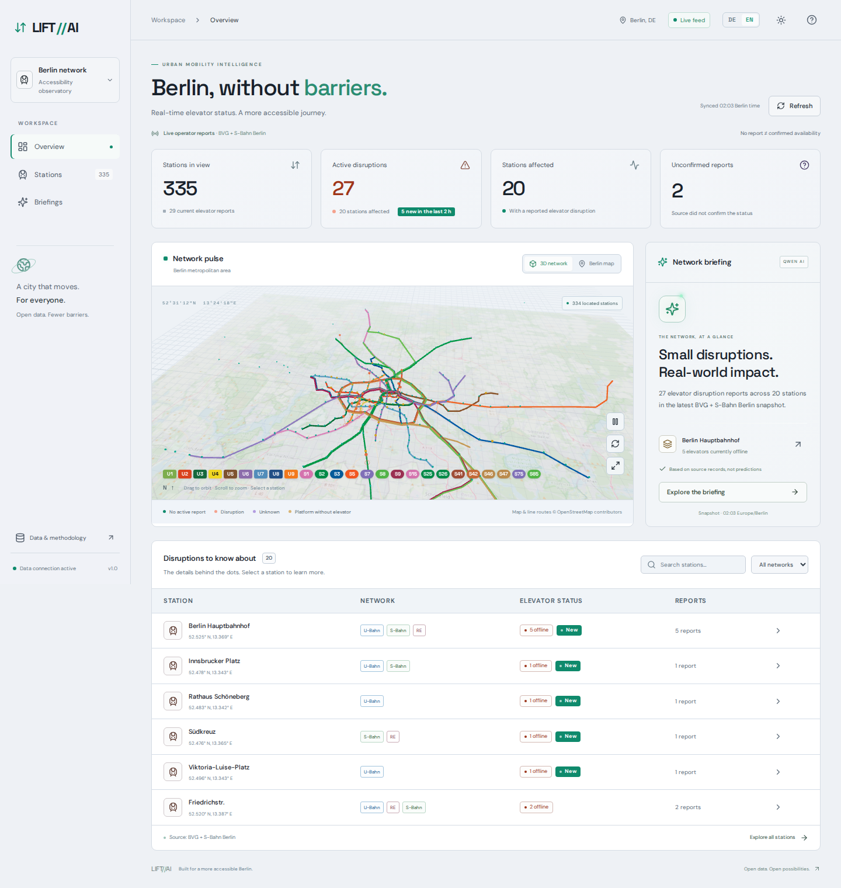
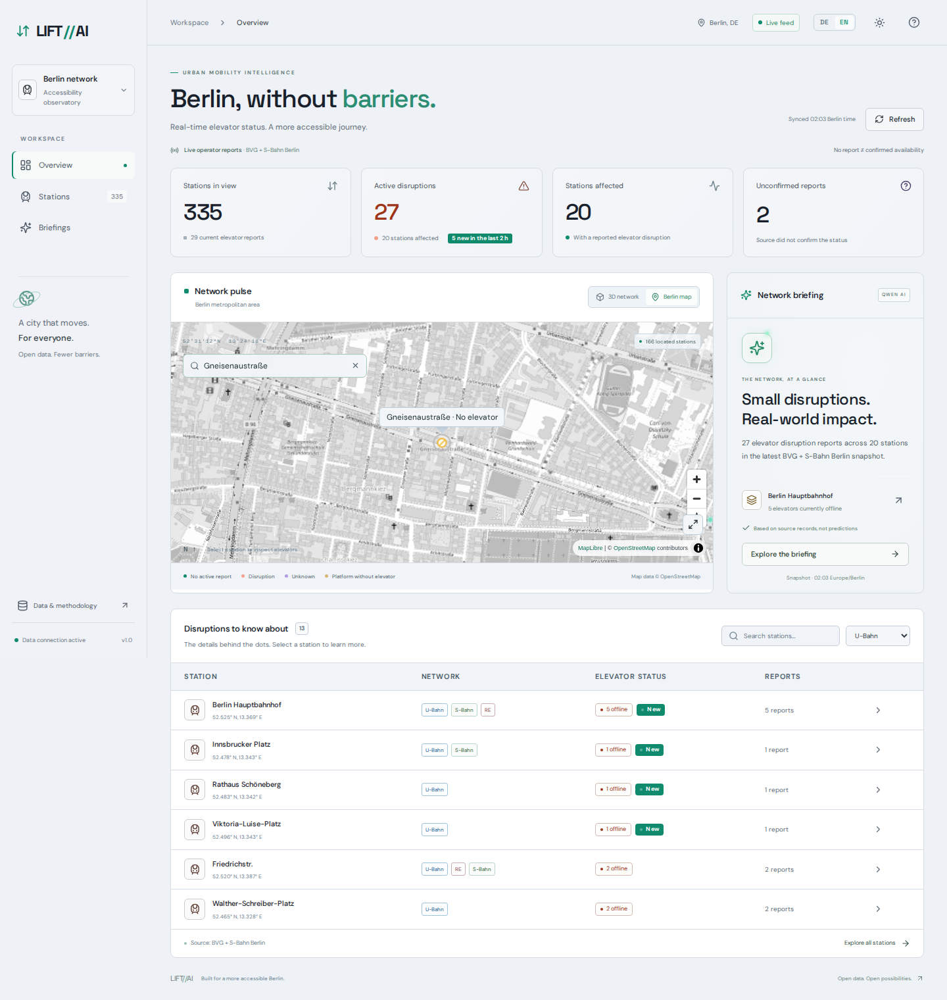
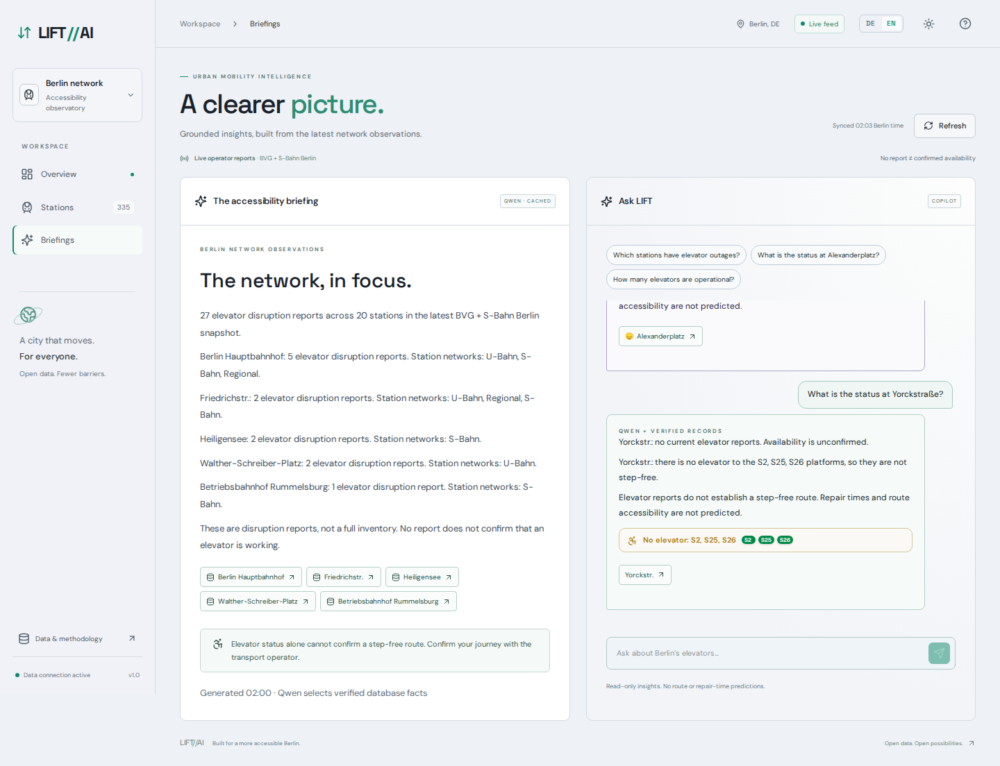
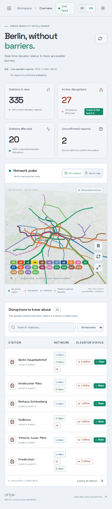

# LIFT//AI

**An accessibility observatory for Berlin's public transport elevators.** Live outage reports from BVG and S-Bahn Berlin, shown on a dashboard with an interactive 3D network, a MapLibre map of Berlin, and AI briefings and a copilot grounded in the database records. Available in English and German.

**Live:** [liftai.fyi](https://liftai.fyi)



| Berlin map | AI briefing + copilot | Mobile |
|---|---|---|
|  |  |  |

## Features

- **Dashboard**: live outage stats, a 24 h trend, filters by network (U-Bahn, S-Bahn, Regional), station search and a station detail view with each elevator's description and observation history.
- **3D network**: a React Three Fiber scene of the real U-Bahn and S-Bahn lines in official BVG/VBB colours over a faint OpenStreetMap base map, with animated outage markers. Lines that share a track run side by side, as on the BVG network map, and a legend highlights one line at a time.
- **Berlin map**: MapLibre with OpenStreetMap tiles and outage indicators per station.
- **AI briefings**: summaries of current disruptions, produced by Qwen 2.5 (0.5B) on Ollama and cached per data snapshot.
- **AI copilot**: natural-language questions such as "What is the status at Alexanderplatz?", answered from the latest records, with links to the source stations.
- **Stations without elevators**: 22 stations without any elevator (e.g. Nöldnerplatz, Moritzplatz, Gneisenaustraße) are listed, mapped in amber and filterable. Lines whose platforms have no elevator at otherwise accessible stations are flagged too, e.g. S2/S25/S26 at Yorckstraße. "No elevator" comes from the BrokenLifts elevator inventory. Stations missing from it are added only when OpenStreetMap also tags them `wheelchair=no`, and "not step-free" is stated only where OSM confirms it.
- **New outages**: elevators that went out of service within the last 2 hours get a "New" badge in the station tables and their own filter. Outages already present when monitoring began are never marked new, because their start time is unknown.
- **Map search**: find a station on the Berlin map. The map flies to it and highlights the marker.
- **Light and dark mode**: the theme menu in the top bar offers System (default, follows the device and updates live), Light, Dark and Daytime (light from sunrise to sunset in Berlin). The choice is remembered and applied before the first paint. `frontend/src/light.css` is generated from the dark stylesheet by `scripts/build-light-theme.py`; re-run it after changing `styles.css`.
- **English and German**: a DE/EN switch translates the whole UI. The backend renders briefings and copilot answers in the selected language from the same evidence, so one cached Qwen selection serves both languages.

## How the AI avoids making things up

The model never writes facts itself. Instead:

1. The backend turns the latest snapshot into a list of **evidence items** with IDs (`network`, `coverage`, `s788` for one station, …). Each item's text is rendered by code from database rows.
2. Qwen is asked to **select** IDs and one of a fixed set of titles. Ollama's structured output (`format` = JSON schema with `enum`s) constrains the response.
3. The response is validated with Pydantic (`extra='forbid'`). Unknown IDs, duplicate IDs, extra prose and invented titles are rejected.
4. Code always adds the coverage caveat, and adds a staleness warning when the snapshot is more than 30 minutes old.
5. If inference fails or times out, or the Ollama service is absent, the API returns the same evidence with a deterministic selection (`mode: "database"`).

Briefings are cached by a SHA-256 fingerprint of the evidence, so a cached selection is never reused after any count or status changes. Questions about repair times, forecasts or step-free routes get an explicit "not supported" answer. These rules are covered by `backend/tests/test_insights.py`.

## Data and its limits

| Source | Used for |
|---|---|
| [BVG disruption reports](https://www.bvg.de/de/verbindungen/stoerungsmeldungen?type=elevator) | U-Bahn elevator outages |
| [S-Bahn Berlin elevator outages](https://sbahn.berlin/fahren/bahnhofsuebersicht/barrierefrei-unterwegs/aufzugs-fahrtreppenstoerung/) | S-Bahn / DB station elevator outages |
| `backend/app/catalog.json` | Station names, coordinates and networks only (no statuses), with locations checked against OpenStreetMap |
| [OpenStreetMap route relations](https://www.openstreetmap.org/copyright) | Ordered stops and colours of U1–U9 and the S-Bahn lines (`frontend/src/data/lines.json`) |

The backend polls every 15 minutes, validates the full response before saving, and stores each snapshot plus per-elevator observations in PostgreSQL. If a refresh fails, it keeps serving the last good snapshot and flags it as stale.

These feeds are **disruption reports, not an inventory**. If no report exists for an elevator, that does not prove the elevator works, and the UI says so. An adapter for [BrokenLifts](https://brokenlifts.org), a full inventory, exists (`SOURCE_MODE=brokenlifts`). It is off in production because BrokenLifts serves a bot challenge to datacenter IPs.

## Architecture

```
React 19 · TypeScript · Vite · Tailwind · shadcn/ui · R3F/Drei · MapLibre
                          │  /api
                       FastAPI ──────────► Ollama (qwen2.5:0.5b, CPU)
                          │  SQLAlchemy        selects evidence IDs only
                     PostgreSQL 17
                          ▲
            BVG + S-Bahn feeds (polled every 15 min)
```

Everything runs on a single-node **k3s** cluster on a Hetzner VPS (2 vCPU, 4 GB RAM, about €5–10/month). The manifests live in `deploy/`:

- `kubernetes.yaml`: Postgres (PVC), backend, frontend (nginx), Traefik ingress, and NetworkPolicies so only the backend can reach Postgres.
- `ollama.yaml`: Ollama with a model PVC, reachable only from the backend. `OLLAMA_KEEP_ALIVE=0` unloads the model between requests, so it uses about 1 GB of RAM only while generating. A request takes about 3 s on the VPS CPU.
- `cloudflare-tunnel.yaml`: a Cloudflare named tunnel for a custom domain over HTTPS without opening inbound ports.
- `preview-tunnel.yaml`: an optional Cloudflare quick tunnel for a temporary public URL. Its hostname changes whenever the pod restarts.

All pods run as non-root with all capabilities dropped. There are no paid APIs and no authentication.

## Run locally

```bash
# Backend (uses SQLite by default; set DATABASE_URL for Postgres)
cd backend && python3 -m venv .venv && .venv/bin/pip install -r requirements.txt
.venv/bin/uvicorn app.main:app --reload --port 8000

# Optional AI (without it the API falls back to database answers)
ollama pull qwen2.5:0.5b
OLLAMA_URL=http://127.0.0.1:11434 LIVE_AI=true .venv/bin/uvicorn app.main:app --port 8000

# Frontend (proxies /api to :8000)
cd frontend && npm ci && npm run dev
```

Tests:

```bash
PYTHONPATH=backend backend/.venv/bin/pytest backend/tests        # data parsing, grounding rules
cd frontend && npx playwright test                               # desktop, mobile, AI flows
TEST_BASE_URL=https://your-host npx playwright test              # against a deployment
```

To refresh the 3D line data, export the route relations with the Overpass query in `scripts/build-lines.py` and run `python3 -I scripts/build-lines.py routes.json`. Stops are snapped to catalog stations, and shortcut edges from route variants that skip a stop are removed. Track curves are simplified to straight segments between stations.

To generate briefings on a laptop instead of the VPS, forward Postgres over SSH and run `scripts/generate-briefing.py` with `DATABASE_URL` and `OLLAMA_URL` set.

## Deploy

Requirements: a VPS with k3s and Docker (Docker is used only to build images) and SSH access.

```bash
DEPLOY_HOST=root@<server> ./scripts/deploy.sh
```

| Variable | Required | Meaning |
|---|---|---|
| `DEPLOY_HOST` | yes | SSH target, e.g. `root@203.0.113.10` |
| `DEPLOY_KEY` | no | SSH private key to use; defaults to your SSH agent/config |
| `DEPLOY_DIR` | no | Install directory on the server, default `/opt/lift-ai` |
| `TUNNEL_TOKEN_FILE` | no | Path on the server to a Cloudflare tunnel token; needed once, then kept as a Kubernetes secret |

The script copies the sources, builds the images on the server, imports them into containerd, creates the database secret on first run, applies the manifests, pulls the Qwen model and waits for the rollouts. No credentials live in the repository: the database password is generated on the server, and the tunnel token is read from a file you place there.

For a public URL, either create a Cloudflare named tunnel (put its token on the server, deploy once with `TUNNEL_TOKEN_FILE`, and route your hostname to `http://frontend.lift-ai.svc.cluster.local:80`), or open TCP 80/443 to the server and point a DNS record at it. The Traefik ingress then serves the app directly.

## API

| Endpoint | Description |
|---|---|
| `GET /api/dashboard` | Latest snapshot, stations, stats, 24 h history |
| `GET /api/stations/{id}/history` | Observation history for one station |
| `GET /api/briefing?lang=en\|de` | Cached grounded briefing |
| `POST /api/copilot` | `{"question": "...", "lang": "en"}` → grounded answer with sources |
| `GET /api/docs` | OpenAPI UI |
